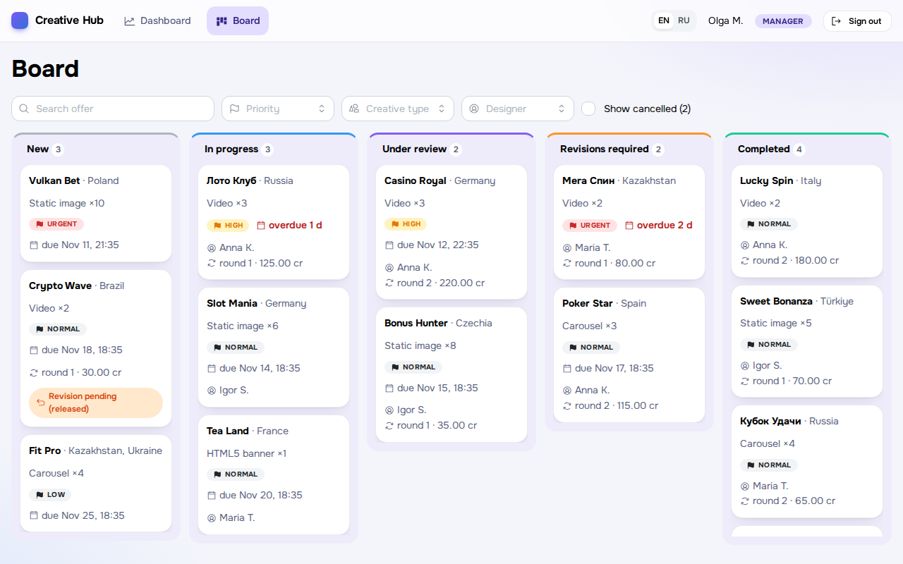
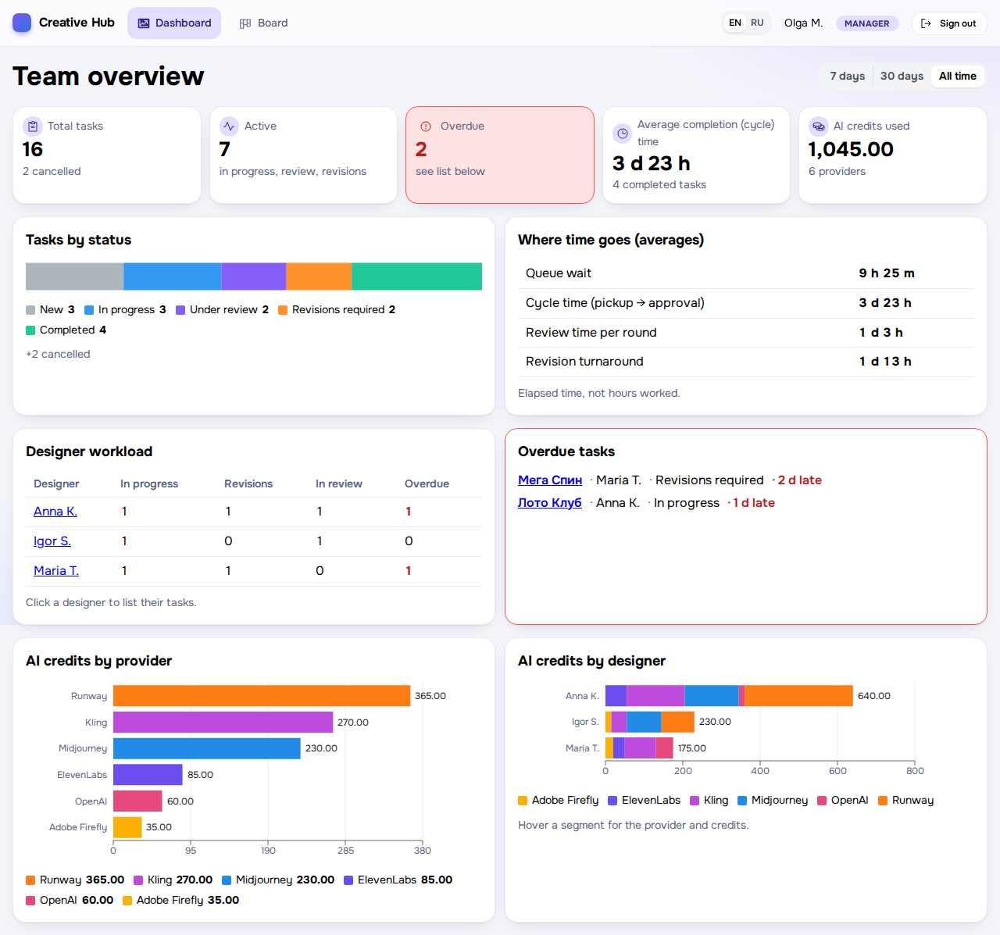
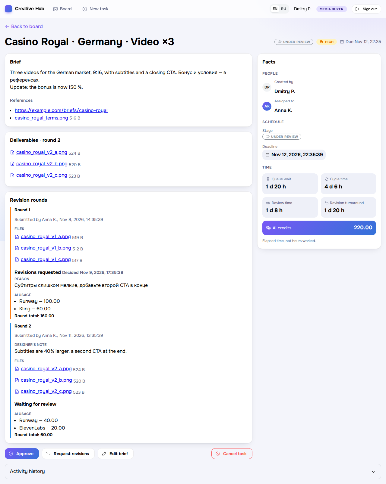
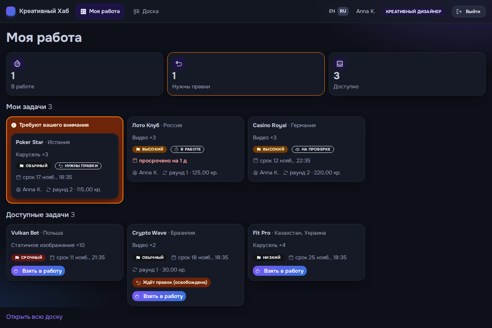
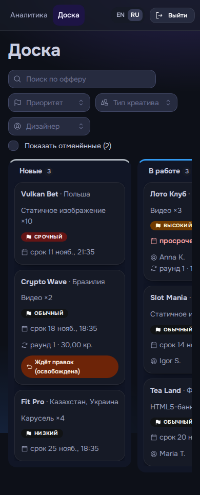
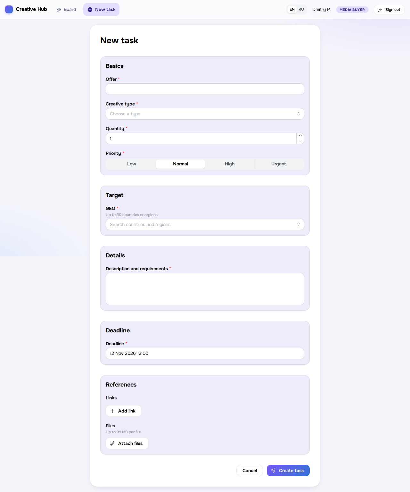
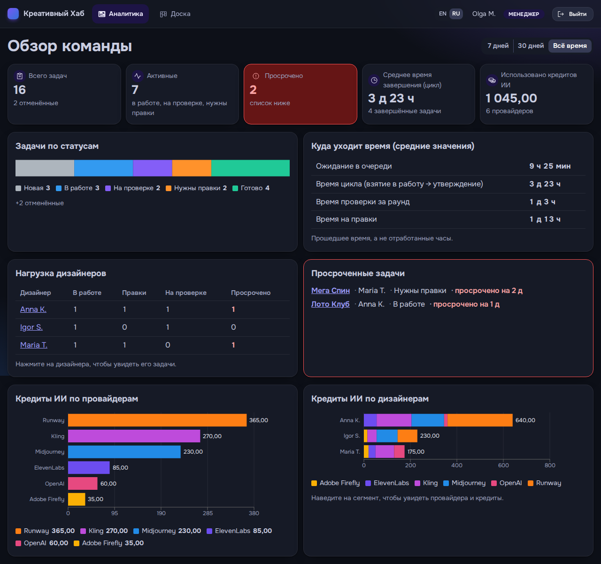

# Creative Hub

**English** · [Русский](README.md)

[](https://github.com/kirsky/creative/actions/workflows/ci.yml)


A mini-service for running a creative department: a media buyer files a brief, a designer picks it up and delivers, the buyer approves or sends it back for revisions, and a manager sees the analytics. Built as a test assignment.

**Demo:** https://creative.indigit.info · usernames and passwords [below](#test-users)



## Features

| Requirement | Implementation |
|---|---|
| Roles | Buyer, designer, manager (read-only). Permissions are enforced on the server |
| Task briefs | Form: offer, GEO, type, quantity, description, references (files and links), priority, deadline. Brief edits are audited |
| Kanban | New → In progress → Under review → Revisions → Done; drag-and-drop and keyboard; filters and search; atomic pick-up |
| Working on tasks | A designer picks a task themselves and submits rounds with files up to 99 MB; the buyer approves or sends it back with a reason |
| Time tracking | Creation, pick-up, submission and completion times; queue wait, cycle, review and revision times |
| AI usage | Service and credits for every round, revisions included |
| Analytics | Tasks by status, workload, average time, overdue tasks, AI credits by service and by designer, period filter |
| History | Immutable event log and field-level audit: who, what, when, old → new |

The UI is available in English and Russian, with light and dark themes and a responsive layout (checked at 390 px).

<details>
<summary>More screenshots</summary>

| | |
|---|---|
| <br>Manager dashboard | <br>Task page: time, rounds, AI usage |
| <br>"My work", dark theme, Russian | <br>Mobile layout |
| <br>New task form | <br>Dashboard, dark theme, Russian |

</details>

## Test users

| Username | Name | Role | Password |
|---|---|---|---|
| `dmitry` | Dmitry P. | Buyer | `qtMkzkzWXnFPbDJP8Eag` |
| `elena` | Elena V. | Buyer | `P456NbBJPQMcKZmTdtug` |
| `anna` | Anna K. | Designer | `78eyynQxM7ghgAmdWu5m` |
| `igor` | Igor S. | Designer | `VhmYHDhEPLvDs6y25eGG` |
| `maria` | Maria T. | Designer | `R9v8dgULBjrvmDFEVHaF` |
| `manager` | Olga M. | Manager | `uwBjFfwZ6CyzHEmArV8u` |

The demo has 16 tasks in every status, including overdue and cancelled ones and tasks with several revision rounds.

**Five-minute check:** `dmitry` creates a task → `anna` picks it up, submits a file and logs AI usage → `dmitry` requests revisions → `anna` resubmits → `dmitry` approves → `manager` opens the dashboard. Details: [review guide](docs/review-guide.md) (RU).

## Tests and quality

**2325 automated tests.** Backend and frontend (2311) run in GitHub Actions on every push; E2E runs locally.

| Layer | Tooling | Tests |
|---|---|---|
| Backend | PHPUnit, integration tests on MariaDB, no DB mocks | **1433** (14,029 assertions) |
| Frontend | Jest, React Testing Library | **878** |
| E2E | Playwright, English and Russian | **14** |

- **Business rules:** every allowed and rejected status transition, the role × action matrix, atomic pick-up under concurrent requests.
- **Security:** access closed by default (a test walks every route), CSRF, login rate limiting, file checks by content.
- **API contract:** every route is checked against OpenAPI 3.1 in both directions, and real responses against its schemas.
- **Static analysis:** PHPStan level 10, PHP CS Fixer (PER), ESLint, Prettier, Stylelint, `tsc --checkJs`, RU/EN translation key parity.

Everything except E2E runs with one command, `make check`. Details: [docs/tests.md](docs/tests.md) (RU).

## Quick start

Requires Docker, Compose and `make`. Nothing else needs to be installed on the host.

```sh
git clone https://github.com/kirsky/creative.git && cd creative
make init && make up && make install   # .env, containers, dependencies
docker compose restart php             # migrations and demo data
make build                             # build the frontend
docker compose exec php composer demo:credentials:rotate   # passwords (shown once)
```

The app runs at http://127.0.0.1:3000. To sign in over plain HTTP, set `SESSION_COOKIE_SECURE=0` in `.env`.
Reset the demo data with `make demo-reset`. More: [deployment](docs/deployment.md) (RU).

## Architecture

- **Backend:** PHP 8.5, Slim 4, PHP-DI, MariaDB 12.3, Phinx. A modular monolith: Identity, Tasks, Rounds, Files, AiUsage, History, Metrics, Analytics. Contract: [OpenAPI 3.1](backend/openapi/openapi.yaml).
- **Frontend:** React 19, Mantine 9, TanStack Query, React Router, dnd-kit, Recharts, react-i18next, Webpack 5.
- **Infrastructure:** Docker Compose (php-fpm, nginx, MariaDB).
- **Metrics from events:** current state lives in `tasks`, and every time metric is derived from the event log.
- **The API returns codes, not prose:** all translations live in the frontend.
- **Security:** argon2id, server-side sessions, CSRF, login rate limiting, files served only through an authorized endpoint, no default passwords.

```text
backend/    Slim API: src/<Module>, db/migrations, openapi/, tests/
frontend/   React SPA: src/features/*, src/i18n, e2e/
docker/     php, nginx, db
docs/       documentation and screenshots
```

Decisions and limitations: [docs/decisions.md](docs/decisions.md) (RU).

## AI tools and agent workflow

Built with **Claude Code** and the **Superpowers** plugin. The human made product decisions and approved the specification, wireframes and plan. The agents worked as a pipeline:

1. **Brainstorm → specification.** Every assumption is tagged `[Spec]`, `[Confirmed]` (agreed with the owner) or `[Call]` (an agent's decision, not agreed).
2. **A 28-task plan**, checked for interface conflicts between tasks before work started.
3. **Subagent execution.** The orchestrator writes no code. Each task gets a fresh implementer subagent (Sonnet; Opus for authentication), then an independent reviewer subagent checks the diff against the spec. Findings go back for fixes, up to 5 rounds. In total, 28 tasks and 37 reviews.
4. **Final review** of the whole branch (Opus) and one fix wave.
5. **Playwright E2E** caught a bug unit tests missed: the production build rendered a blank page.
6. **The UI redesign** ran as a separate specification → plan → execution cycle.

Details and examples of caught defects: [docs/ai-workflow.md](docs/ai-workflow.md) (RU).

## Documentation (in Russian)

[Review guide](docs/review-guide.md) · [Decisions and limitations](docs/decisions.md) · [Tests](docs/tests.md) · [AI workflow](docs/ai-workflow.md) · [Deployment](docs/deployment.md)

## License

[GPL-3.0](LICENSE)
