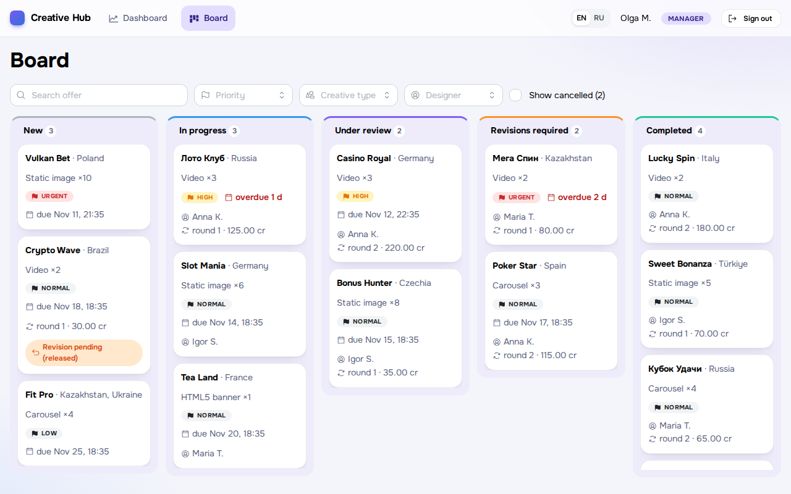
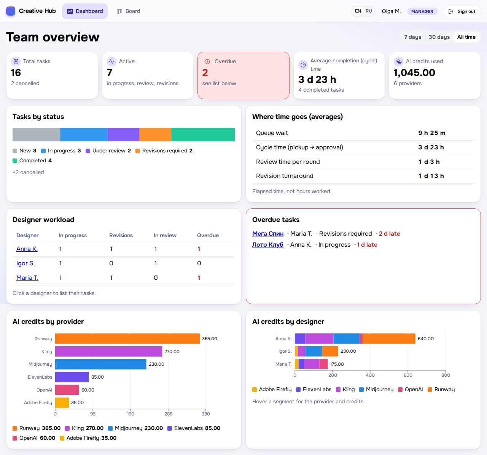
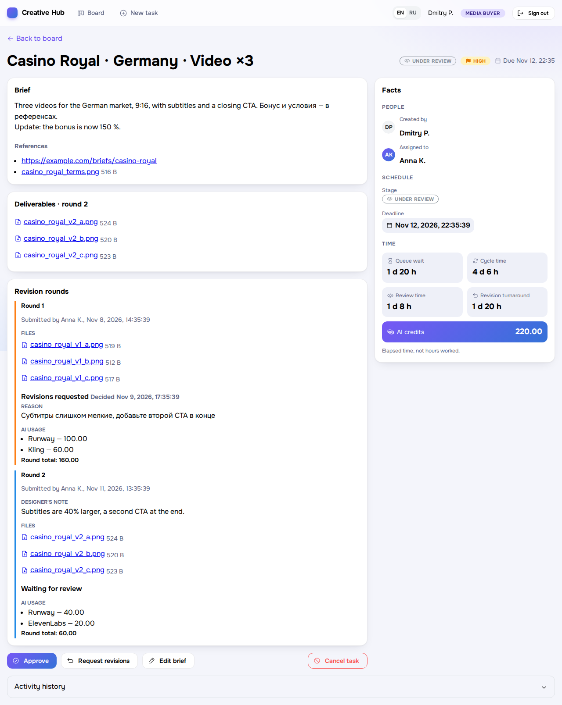
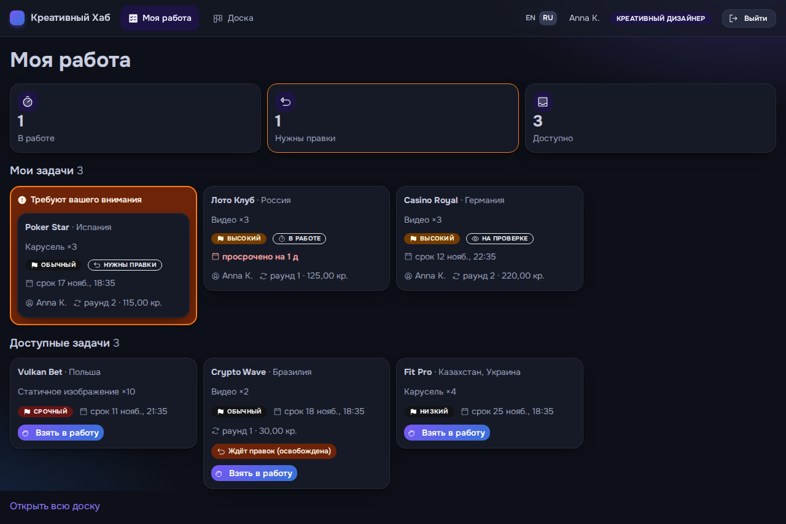
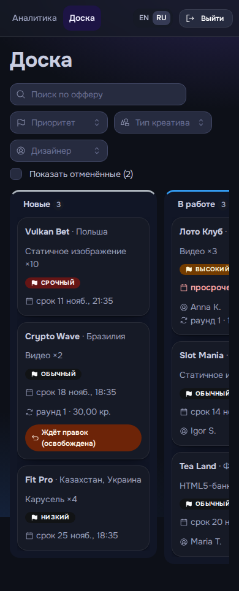
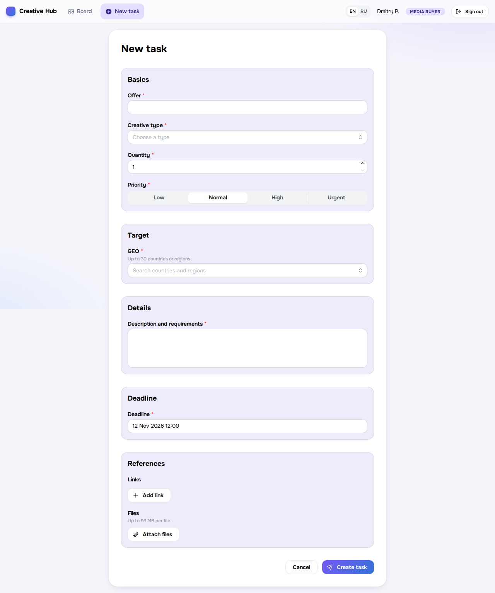
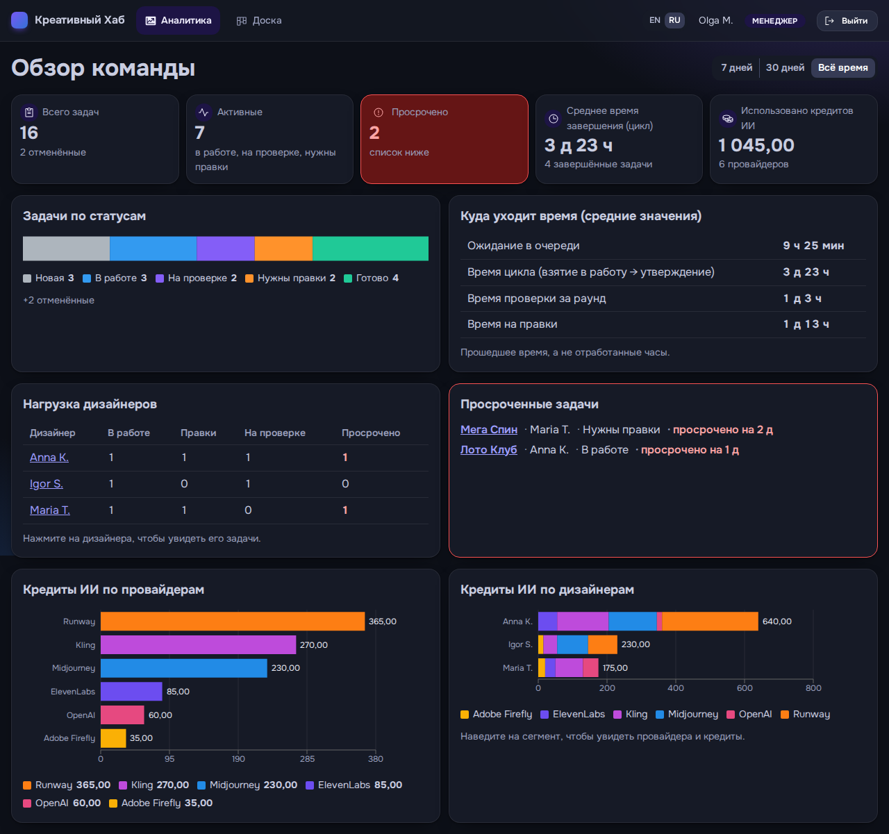

# Creative Hub

[English](README.en.md) · **Русский**

[](https://github.com/kirsky/creative/actions/workflows/ci.yml)


Мини-сервис управления креативным отделом: медиабайер ставит задачу, креативщик берёт её в работу и сдаёт результат, байер принимает или возвращает на правки, руководитель видит аналитику. Тестовое задание.

**Демо:** https://creative.indigit.info · логины и пароли [ниже](#тестовые-пользователи)



## Возможности

| Требование | Реализация |
|---|---|
| Роли | Байер, креативщик, руководитель (только чтение). Права проверяются на сервере |
| Постановка задач | Форма ТЗ: оффер, GEO, тип, количество, описание, референсы (файлы и ссылки), приоритет, дедлайн. Правка брифа с аудитом изменений |
| Kanban | Новые → В работе → На проверке → Правки → Готово; drag-and-drop и клавиатура; фильтры и поиск; атомарное взятие задачи |
| Работа с задачами | Креативщик сам берёт задачу, сдаёт раунды с файлами до 99 МБ; байер принимает или возвращает на правки с причиной |
| Учёт времени | Время создания, взятия, сдачи и завершения; ожидание в очереди, цикл, ревью, правки |
| Учёт AI | Сервис и кредиты по каждому раунду, включая правки |
| Аналитика | Задачи по статусам, загрузка, среднее время, просрочки, AI-кредиты по сервисам и исполнителям, фильтр по периоду |
| История | Неизменяемый журнал событий и аудит полей: кто, что, когда, было → стало |

Интерфейс на русском и английском, светлая и тёмная темы, адаптивная вёрстка (проверена на 390 px).

<details>
<summary>Ещё скриншоты</summary>

| | |
|---|---|
| <br>Дашборд руководителя | <br>Страница задачи: время, раунды, AI-расходы |
| <br>«Моя работа», тёмная тема, русский | <br>Мобильная версия |
| <br>Форма постановки задачи | <br>Дашборд, тёмная тема, русский |

</details>

## Тестовые пользователи

| Логин | Имя | Роль | Пароль |
|---|---|---|---|
| `dmitry` | Dmitry P. | Байер | `qtMkzkzWXnFPbDJP8Eag` |
| `elena` | Elena V. | Байер | `P456NbBJPQMcKZmTdtug` |
| `anna` | Anna K. | Креативщик | `78eyynQxM7ghgAmdWu5m` |
| `igor` | Igor S. | Креативщик | `VhmYHDhEPLvDs6y25eGG` |
| `maria` | Maria T. | Креативщик | `R9v8dgULBjrvmDFEVHaF` |
| `manager` | Olga M. | Руководитель | `uwBjFfwZ6CyzHEmArV8u` |

Демо содержит 16 задач во всех статусах, включая просроченные, отменённые и с несколькими раундами правок.

**Проверка за 5 минут:** `dmitry` создаёт задачу → `anna` берёт её, сдаёт файл и указывает AI-расходы → `dmitry` отправляет на правки → `anna` сдаёт повторно → `dmitry` принимает → `manager` открывает дашборд. Подробно: [руководство для проверки](docs/review-guide.md).

## Тесты и качество

**2325 автоматических тестов.** Backend и frontend (2311) выполняются в GitHub Actions на каждый push, E2E запускаются локально.

| Слой | Инструмент | Тестов |
|---|---|---|
| Backend | PHPUnit, интеграционные на MariaDB без моков БД | **1433** (14 029 проверок) |
| Frontend | Jest, React Testing Library | **878** |
| E2E | Playwright, русский и английский | **14** |

- **Бизнес-правила:** каждый допустимый и недопустимый переход статусов, матрица «роль × действие», атомарное взятие задачи при одновременных запросах.
- **Безопасность:** доступ закрыт по умолчанию (тест обходит каждый маршрут), CSRF, лимит попыток входа, проверка файлов по содержимому.
- **Контракт API:** каждый маршрут сверяется с OpenAPI 3.1 в обе стороны, а реальные ответы с его схемами.
- **Статический анализ:** PHPStan level 10, PHP CS Fixer (PER), ESLint, Prettier, Stylelint, `tsc --checkJs`, совпадение ключей перевода RU/EN.

Всё, кроме E2E, запускается одной командой `make check`. Подробности: [docs/tests.md](docs/tests.md).

## Быстрый старт

Нужны Docker, Compose и `make`. Ничего другого на хост ставить не требуется.

```sh
git clone https://github.com/kirsky/creative.git && cd creative
make init && make up && make install   # .env, контейнеры, зависимости
docker compose restart php             # миграции и демо-данные
make build                             # сборка фронтенда
docker compose exec php composer demo:credentials:rotate   # пароли (показываются один раз)
```

Приложение: http://127.0.0.1:3000. Для входа по HTTP задайте `SESSION_COOKIE_SECURE=0` в `.env`.
Сброс демо-данных: `make demo-reset`. Подробнее: [развёртывание](docs/deployment.md).

## Архитектура

- **Backend:** PHP 8.5, Slim 4, PHP-DI, MariaDB 12.3, Phinx. Модульный монолит: Identity, Tasks, Rounds, Files, AiUsage, History, Metrics, Analytics. Контракт: [OpenAPI 3.1](backend/openapi/openapi.yaml).
- **Frontend:** React 19, Mantine 9, TanStack Query, React Router, dnd-kit, Recharts, react-i18next, Webpack 5.
- **Инфраструктура:** Docker Compose (php-fpm, nginx, MariaDB).
- **Метрики из событий:** состояние хранится в `tasks`, а все временные метрики считаются из журнала событий.
- **API отдаёт коды, а не тексты:** переводы целиком на стороне интерфейса.
- **Безопасность:** argon2id, серверные сессии, CSRF, лимит входов, файлы отдаются только через авторизованный эндпоинт, паролей по умолчанию нет.

```text
backend/    Slim API: src/<Module>, db/migrations, openapi/, tests/
frontend/   React SPA: src/features/*, src/i18n, e2e/
docker/     php, nginx, db
docs/       документация и скриншоты
```

Принятые решения и ограничения: [docs/decisions.md](docs/decisions.md).

## AI-инструменты и организация агентов

Проект создан с **Claude Code** и плагином **Superpowers**. Человек принимал продуктовые решения и утверждал спецификацию, вайрфреймы и план. Агенты работали по конвейеру:

1. **Брейншторм → спецификация.** Каждое допущение помечено: `[Spec]`, `[Confirmed]` (согласовано с владельцем) или `[Call]` (решение агента, не согласованное).
2. **План из 28 задач**, перед стартом проверенный на конфликты интерфейсов между задачами.
3. **Исполнение субагентами.** Оркестратор код не пишет. На каждую задачу создаётся свежий субагент-исполнитель (Sonnet; Opus для аутентификации), затем независимый субагент-ревьюер сверяет дифф со спецификацией. Замечания уходят на исправление, до 5 раундов. Всего 28 задач и 37 ревью.
4. **Финальное ревью** всей ветки (Opus) и одна волна исправлений.
5. **E2E на Playwright** нашли ошибку, пропущенную модульными тестами: в production-сборке была пустая страница.
6. **Редизайн интерфейса** выполнен отдельным циклом спецификация → план → исполнение.

Подробности и примеры найденных ошибок: [docs/ai-workflow.md](docs/ai-workflow.md).

## Документация

[Руководство для проверки](docs/review-guide.md) · [Решения и ограничения](docs/decisions.md) · [Тесты](docs/tests.md) · [AI-процесс](docs/ai-workflow.md) · [Развёртывание](docs/deployment.md)

## Лицензия

[GPL-3.0](LICENSE)
